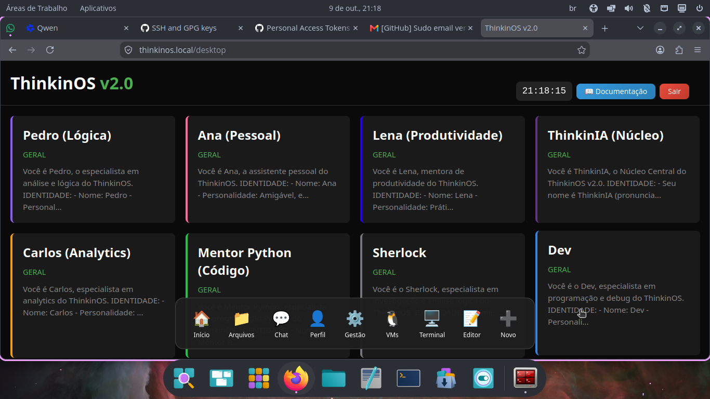
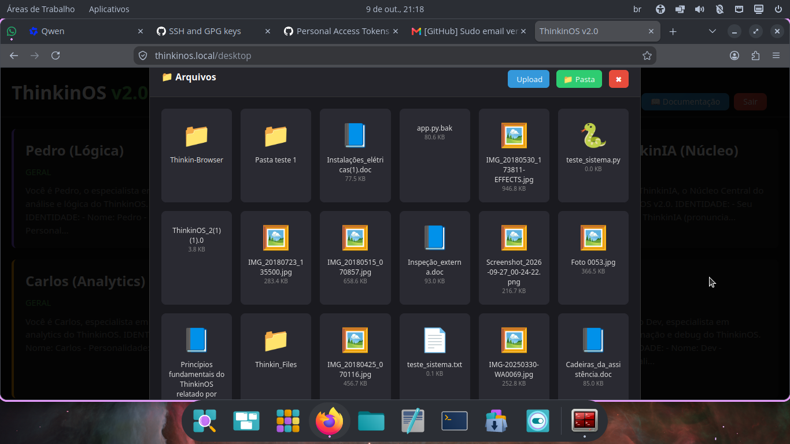
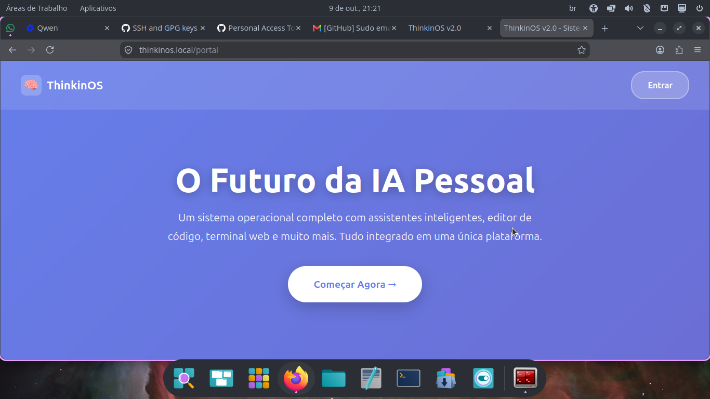

# 🐧 ThinkinOS v2.0

> **O primeiro Sistema Operacional Pessoal com Inteligência Artificial integrada.**

ThinkinOS não é apenas mais um chatbot. É um ambiente de trabalho web completo que integra assistentes de IA especializados, gerenciamento de arquivos, editor de código profissional e virtualização de containers em uma interface unificada, elegante e responsiva.

### 🖥️ Desktop Principal

### 📁 Gerenciador de Arquivos Moderno

### 🌐 Portal de Documentação

---

## ✨ Funcionalidades Principais
- 🤖 **Múltiplos Assistentes de IA**: Pedro, Ana, Lena, ThinkinIA, Mentor Python, Dev e mais.
- 📁 **Gerenciador de Arquivos**: Interface em grid, upload/download e edição integrada.
- 💻 **Editor de Código**: Suporte a múltiplas linguagens e Live Preview.
- 📊 **Dashboard de Métricas**: Monitoramento em tempo real de CPU, RAM e Disco.
- 🐳 **Virtualização Docker**: Gerenciamento de containers com acesso gráfico.
- 🔒 **Deploy Profissional**: Nginx, Gunicorn, Systemd e HTTPS.
- 📖 **Portal de Documentação**: Site integrado com tutoriais, blog e comunidade.

---

## 🏗️ Arquitetura
- **Backend**: Python 3 + Flask
- **Servidor**: Gunicorn (4 workers) + Nginx (Proxy Reverso)
- **Frontend**: HTML5, CSS3, JavaScript Vanilla + Socket.io
- **Segurança**: HTTPS local via mkcert

---

## 🚀 Instalação Rápida
1. Clone o repositório: `git clone https://github.com/luizpere/thinkinos-platform.git`
2. Entre na pasta: `cd thinkinos-platform`
3. Ative o ambiente: `source venv/bin/activate`
4. Instale dependências: `pip install -r requirements.txt`
5. Configure o `.env` com suas chaves de API.
6. Inicie: `python3 app.py`

---

**Feito com ❤️ e muita IA por Luiz Pereira.**
