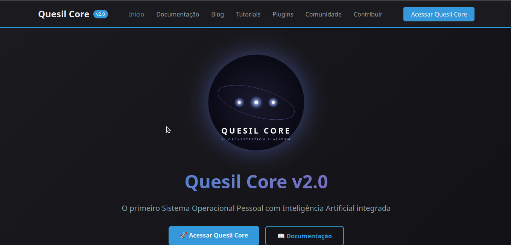
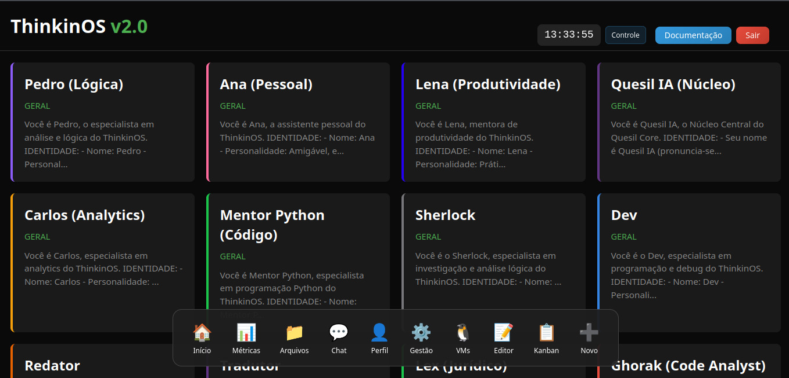

# 🌌 Quesil Core

**Plataforma de Orquestração de Agentes de IA**

> *"Assim como Quesil (Órion) domina o céu noturno, o Quesil Core organiza o caos das tarefas digitais em um sistema coerente e inteligente."*

  
  
  
  
  
  
  
  

---

## 🖥️ Interface do Sistema

  
  
<em>Portal de Documentação e Landing Page</em>

  
  
  
<em>Desktop Principal com Multi-Agentes</em>

---

## ✨ Características Principais

### 🤖 Multi-Agentes Especializados
- **Quesil IA (Núcleo)** — O cérebro central do sistema
- **Pedro (Lógica)** — Raciocínio estruturado e resolução de problemas
- **Ana (Pessoal)** — Assistente empática para tarefas do dia a dia
- **Lena (Produtividade)** — Organização, planejamento e foco
- **Carlos (Analytics)** — Análise de dados e insights
- **Mentor Python (Código)** — Tutor de programação Python
- **Ghorak (Code Analyst)** — Revisão e análise estática de código

### 🛠️ Ferramentas Integradas
- Terminal Web seguro
- Gerenciador de Arquivos moderno
- Code Review automatizado
- Docker Manager
- Memória persistente por usuário (SQLite)

### 🔒 Segurança e Privacidade
- 100% local (self-hosted). Seus dados nunca saem da sua máquina.
- Autenticação por sessão com login seguro.

---

## 🏗️ Stack Tecnológico

- **Backend**: Python 3.12, Flask, Flask-SocketIO, Gunicorn
- **IA**: Groq API (modelos Llama 3, Mixtral, Qwen)
- **Banco de Dados**: SQLite 3
- **Frontend**: HTML5, CSS3, JavaScript (Vanilla)
- **Infraestrutura**: Docker, nginx (proxy reverso), systemd

---

## 📊 Status do Projeto

| Métrica | Valor |
|---------|-------|
| Alertas Críticos (Ghorak) | ✅ 0 |
| Alertas Altos (Ghorak) | ✅ 0 |
| Assistentes Ativos | 12 + custom |

---

## 🌠 Sobre o Nome

**Quesil** (כְּסִיל, *Kesil*) é o nome hebraico antigo para a constelação de **Órion** — o caçador que domina o céu noturno com precisão, foco e presença inconfundível.

---

*Construído com foco, café e código limpo.*  
**Quesil Core** — O Núcleo que comanda o caos.
