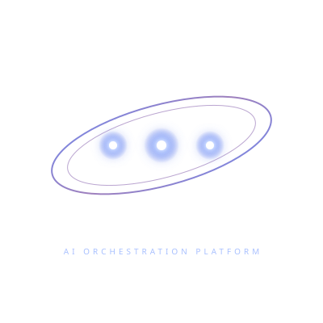

# 🌌 Quesil Core

**Plataforma de Orquestração de Agentes de IA**

> *"Assim como Quesil (Órion) domina o céu noturno, o Quesil Core organiza o caos das tarefas digitais em um sistema coerente e inteligente."*

  
  
<em>AI Orchestration Platform</em>

---

##  Visão Geral

O **Quesil Core** é uma plataforma web local de produtividade e orquestração de inteligência artificial. Inspirado na constelação de **Quesil** (Órion, o caçador da mitologia e astronomia antiga), o sistema atua como um **núcleo central** que coordena múltiplos assistentes especializados.

## ✨ Características Principais

### 🤖 Multi-Agentes Especializados
- **Quesil IA (Núcleo)** — O cérebro central do sistema
- **Pedro (Lógica)** — Raciocínio estruturado
- **Ana (Pessoal)** — Tarefas do dia a dia
- **Lena (Produtividade)** — Organização e planejamento
- **Carlos (Analytics)** — Análise de dados
- **Mentor Python (Código)** — Tutor de programação
- **Sherlock** — Investigação e pesquisa
- **Lex (Jurídico)** — Documentos legais
- **Ghorak (Code Analyst)** — Revisão de código

### 🛠️ Ferramentas Integradas
- Terminal Web
- Gerenciador de Arquivos
- Code Review automatizado
- Docker Manager
- Memória persistente por usuário

### 🔒 Segurança
- 100% local (self-hosted)
- Dados nunca saem da sua máquina
- Autenticação segura por sessão

## ️ Stack Técnico

- **Backend**: Python 3.12, Flask, Gunicorn
- **IA**: Groq API (Llama 3, Mixtral, Qwen)
- **Banco de Dados**: SQLite 3
- **Frontend**: HTML5, CSS3, JavaScript
- **Infraestrutura**: Docker, nginx, systemd

## 📊 Status do Projeto

| Métrica | Valor |
|---------|-------|
| Alertas Críticos (Ghorak) | ✅ 0 |
| Alertas Altos (Ghorak) | ✅ 0 |
| Assistentes Ativos | 12 + custom |

##  Sobre o Nome

**Quesil** (כְּסִיל) é o nome hebraico antigo para a constelação de **Órion** — o caçador que domina o céu noturno com precisão e foco.

---

*Construído com foco, café e código limpo.*  
**Quesil Core** — O Núcleo que comanda o caos.
